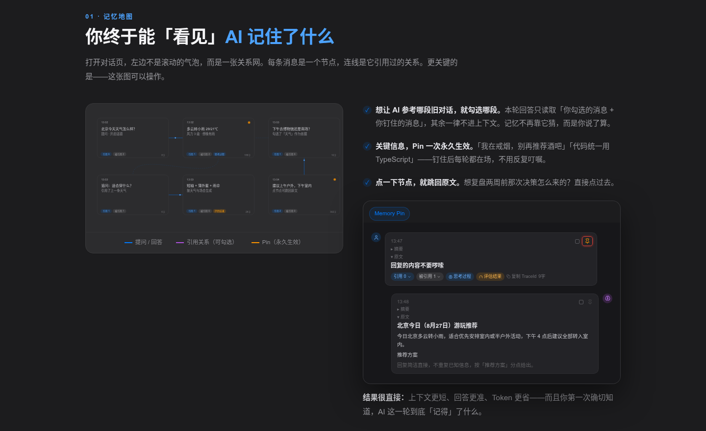
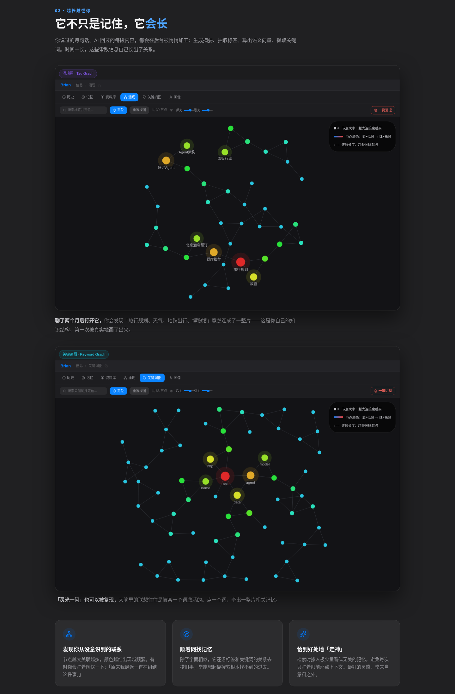
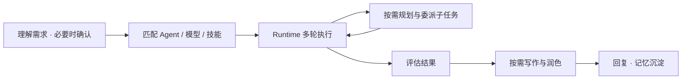

# Brian-Agent

一个会记住你、能持续学习的**本地个人 Agent**：把对话变成可操作的记忆地图，把本地笔记变成可检索、可问答的第二大脑。

对话被组织成一张可操作的**记忆地图**：想让 AI 参考哪段旧对话就勾选哪段，关键信息可以 Pin 钉选；上下文按**七路混合召回**取材；一支多 Agent 团队负责规划、执行、写作与评估，并从你的文档与对话中持续学习进化。**数据本地存储，模型提供商可配置。**

> 本地存储不等于离线推理：使用远程 LLM、Embedding 或 MCP 服务时，参与调用的提示词、记忆和资料片段会发送给对应服务。数据流向取决于你配置的模型与工具。

[](LICENSE)


<details>
<summary>📷 产品预览（点击展开）</summary>






</details>

## 核心特性

| 特性 | 说明 |
|------|------|
| **ChatMap 记忆地图** | 对话是一张可操作的关系图：勾选引用、Pin 钉住、点节点跳回原文，上下文由你说了算 |
| **七路混合记忆召回** | 钉选、引用、时间线、标签关联、向量相似、关键词、随机七类来源，支持配置优先级与数量上限，去重后组装上下文 |
| **涌现图 & 关键词图** | 基于共现关系的知识图谱，自动发现记忆中的隐藏关联，反哺检索质量 |
| **多 Agent 协作** | 意图理解、Agent 与模型匹配、任务拆解与委派；Runtime 管理多轮执行和子任务，完成后评估并按需写作 |
| **自我进化闭环** | 从文档 / 对话 / Tag 图三种模式自学习，结合评估结果与进化报告沉淀知识；学习过程可启动、暂停和查看 |
| **Soul 人格 & 用户画像** | 每个 Agent 绑定人格灵魂；画像持续沉淀，可回溯「它眼中的我」的历史版本 |
| **CDT 浏览器自动化** | 通过 Chrome DevTools 执行页面操作与脚本，支持配置浏览器 Profile 快照以复用登录态 |
| **资料库阅读器** | 本地 Markdown 目录接入，划词即问，问答以纸质书边注形态对齐正文 |
| **技能沙箱** | isolated-vm 硬隔离执行；沙箱初始化失败拒绝启动，绝不静默降级 |
| **全链路可观测** | 需求确认、执行时间线、Token/耗时、评分反馈、TraceID 复盘，没有一个黑盒 |
| **本地存储与模型配置** | 对话 / 记忆 / 资料 / 画像保存在本地；API Key 自行配置，可按日 / 周 / 月限制 Token 或调用次数 |

### 页面与使用入口

| 页面 | 路由 | 用途 |
|------|------|------|
| 首页 | `/` | 记忆地图、持续学习、可见的思考、第二大脑与数据归属介绍 |
| 对话 | `/chat` | 发起对话，勾选历史引用、钉选记忆、查看思考过程和评估结果 |
| 信息 | `/info` | 问答历史、记忆、资料库、标签图、关键词图与用户画像 |
| 学习 | `/learning` | 控制自学习，查看进度与学习成果 |
| 监控 | `/monitor` | 查看运行状态、用量、日志与调用链 |
| 配置 | `/config` | 管理模型提供商、可用模型及各模块参数 |
| 工具 | `/tool` | ID 生成、JSON / XML 校验与格式化、正则测试 |
| 定时任务 | `/cron` | 管理定时任务 |

首页包含示例对话、图谱和流程演示；执行概览在接口有数据时展示最近一次问答统计。实际对话请进入 `/chat`。

### 多 Agent 执行流程



简单任务可直接输出，不要求每次都组队、生成 DAG 或调用 Writer。评估与写作的执行也取决于运行结果和配置。

## 快速开始

```bash
# 1. 在仓库根目录构建并安装（构建前需准备 Node 22 与 Python 3.8+）
python3 packaging/pack.py --targets linux-x64            # 构建机需 Node 22
bash packaging/install.sh --from dist-pack/brian-agent-linux-x64.tar.gz

# 2. 启动
brian start           # → http://127.0.0.1:8000

# 3. 打开 /config 配置提供商与可用模型，再进入 /chat 对话
```

首次使用建议：

1. 在 `/config` 的模型配置中填写提供商地址与 API Key，获取模型列表并添加要使用的模型；Embedding 模型按记忆检索需要配置。
2. 到 `/chat` 发起对话，在记忆地图中勾选历史消息作为引用，或 Pin 需要持续参考的内容。钉选仍受上下文数量与模型窗口限制。
3. 在 `/info` 的资料库中接入本地 Markdown 目录；需要持续学习时，到 `/learning` 启动并查看进度。

源码运行见下方「常驻服务与开发模式」，无需先制作发行包。

## 安装部署

| 方式 | 平台 | 前置条件 | 状态 |
|------|------|---------|------|
| [A · 一键脚本](#a--一键脚本linux--macos) | Linux / macOS | 无需 Node | 需先发布对应 Release 产物 |
| [B · npm 全局包](#b--npm-全局包) | 全平台 | Node 18+ | 需先发布 npm 包及 Release 产物 |
| [C · 离线安装](#c--离线安装当前推荐) | 全平台 | 构建机 Node 22 | ✅ 当前推荐 |
| [D · 便携模式](#d--便携模式解压即用) | 全平台 | 无 | ✅ 可用 |

> A / B 依赖维护者发布 GitHub Releases 平台产物与 npm 包；仓库内的安装脚本不代表在线产物已就绪。发布流程见 [packaging/npm/README.md](packaging/npm/README.md)。

### A · 一键脚本（Linux / macOS）

```bash
curl -fsSL https://raw.githubusercontent.com/zhaoxuan-inside/brian-agent/main/packaging/install.sh | bash
# 可选：--systemd 注册常驻服务；--from <file> 离线安装

# Windows（PowerShell）
iwr https://raw.githubusercontent.com/zhaoxuan-inside/brian-agent/main/packaging/install.ps1 -OutFile install.ps1; .\install.ps1
```

### B · npm 全局包

```bash
npm i -g brian-agent      # postinstall 自动下载平台运行时；失败可 npm rebuild -g 重试
```

### C · 离线安装（当前推荐）

在有网的构建机上打包，拷贝到目标机安装。不依赖任何外部发布，支持交叉打包全部平台：

```bash
python3 packaging/pack.py                              # 全部 4 目标 + .deb + SHA256SUMS
python3 packaging/pack.py --targets linux-x64,win32-x64  # 仅指定目标
python3 packaging/pack.py --skip-chromium                # 不内置 Chrome（-150MB/目标）

# 目标机安装
bash packaging/install.sh --from dist-pack/brian-agent-linux-x64.tar.gz   # Linux / macOS
.\packaging\install.ps1 -From dist-pack\brian-agent-win32-x64.zip                # Windows
sudo dpkg -i dist-pack/brian-agent-linux-x64.deb                       # Linux .deb（含 /usr/bin/brian）
```

### D · 便携模式（解压即用）

发行包解压后可直接运行，默认仍使用用户数据目录（见下方）。Linux / macOS 若需让数据跟包走，可在包根目录执行 `BRIAN_DATA_DIR="$PWD/data" ./brian.sh start`。

| 平台 | 产物 | 启动 |
|------|------|------|
| Linux | `brian-agent-linux-x64.tar.gz` / `.deb` | `./brian.sh start`；`.deb` 装后直接 `brian` |
| macOS | `brian-agent-darwin-*.tar.gz` | `xattr -dr com.apple.quarantine brian-agent-*` → `./brian.sh start` |
| Windows | `brian-agent-win32-x64.zip` | `brian.cmd start` |

> Intel Mac（darwin-x64）暂未内置 isolated-vm 预编译件，当前代码直接初始化沙箱，没有自动降级分支；缺失该模块会导致启动失败，需先补齐兼容的原生模块。

### 系统要求

| 项目 | 要求 |
|------|------|
| 操作系统 | Linux x64（glibc ≥ 2.28）· macOS（Apple Silicon；Intel 见上方限制）· Windows x64 |
| Node.js | 目标机运行发行包无需另装 Node；npm 安装器需 18+；源码开发与构建需 Node 22 |
| 技能运行时 | 默认打包 Python；Windows 另含 bash / coreutils。使用 `--skip-runtime` 或技能依赖额外程序时，需自行准备相应环境 |
| 磁盘 | 1GB 以上（内置 Chrome for Testing 时更大） |

### 常驻服务与开发模式

```bash
# systemd 常驻（.deb 已包含服务；一键脚本需安装时传 --systemd）
sudo systemctl enable --now brian-agent

# 开发模式（源码运行）
git clone https://github.com/zhaoxuan-inside/brian-agent.git && cd brian-agent
# 1) 要求 Node 22（.nvmrc 锁定，prebuilt 原生模块按 Node 22 ABI 预编译）
nvm install 22.22.1 && nvm use 22.22.1     # 或 mise use node@22.22.1 / fnm use
# 2) 安装依赖（postinstall 自动就位原生模块并构建后端）
npm install
# 3) 启动（环境有问题时会先给出自检引导）
./brian start          # 后台启动；浏览器访问 http://127.0.0.1:5173（后端 :8000）
./brian doctor         # 环境自检
./brian dev            # 前台全栈，Ctrl+C 一键停止

# Windows 原生（无需 WSL）: brian.cmd start / doctor / stop ...（与 bash 版同一实现）
# 重装/重置: ./brian clean --all → npm install（Linux/macOS/Windows 全平台一致）
```

### 环境变量

| 变量 | 默认值 | 说明 |
|------|--------|------|
| `BRIAN_PORT` | `8000` | 后端端口 |
| `BRIAN_HOST` | `127.0.0.1` | 监听地址（对外设 `0.0.0.0`） |
| `BRIAN_DATA_DIR` | 随运行方式变化，见下表 | 后端数据目录 |
| `BRIAN_WEB_PORT` | `5173` | Vite 开发服务端口；源码 CLI 的状态检查与打开命令仍固定使用 5173 |
| `BRIAN_API_PORT` | `8000` | Vite 代理的后端目标端口；修改开发后端端口时需与 `BRIAN_PORT` 一起设置 |

默认数据目录：

| 运行方式 | 目录 |
|----------|------|
| 源码运行 | `brian-backend/data` |
| Linux / macOS 发行包启动脚本 | `~/.brian-agent` |
| Windows 发行包启动脚本 | `%APPDATA%\brian-agent` |
| 发行包 systemd 系统服务 | `/var/lib/brian-agent` |

Linux / macOS 启动脚本尊重显式设置的 `BRIAN_DATA_DIR`；当前 Windows 发行包脚本会将它重设为上述用户目录。升级前保留并备份实际数据目录，尤其是自行设置在包内的目录。

## brian CLI（源码开发）

| 命令 | 说明 | 命令 | 说明 |
|------|------|------|------|
| `brian start [svc]` | 后台启动 | `brian stop [svc]` | 优雅停止 |
| `brian restart [svc]` | 重启 | `brian status` | 运行状态 |
| `brian logs [svc]` | 跟踪日志 | `brian open` | 浏览器打开前端 |
| `brian dev` | 前台全栈 | `brian serve` | 前台 headless 后端 |
| `brian doctor` | 环境自检 | `brian clean [--all]` | 清理日志与 PID；--all 深度清理 |

> 源码目录中使用 `./brian`，Windows 使用 `.\brian.cmd`，二者共用 Node CLI。发行包提供 `start / stop / restart / status / logs / open / serve`；`dev / doctor / clean` 属于源码开发 CLI。

## 架构

npm workspaces 单仓库，后端按分层模块组织，主要构建依赖顺序为 `shared → base → core → agent → runtime → application`（箭头表示先构建再被后层使用）。Runtime 依赖 Agent；前端使用 shared 契约，通过 HTTP / SSE / WebSocket 访问后端。

| 包 | 层级 | 职责 |
|----|------|------|
| `@brian-agent/base` | 基础构件层 | RelationDB(SQLite) / GraphDB / VectorDB(LanceDB) / LLM / MCP / MQ / CDT / Prompts / Skill 沙箱 / Soul / Cron / Stream |
| `@brian-agent/core` | 基础层 | InfoCore(记忆核心) / LLMCore / MCPCore / SkillCore / SoulCore / MQCore / CDTCore |
| `@brian-agent/runtime` | 编排内核 | Runtime v2「代码即编排」：Session / Runs / 两级 Agent Loop（迭代预算 + 真取消）/ SkillRuntime（Skill 与 MCP 承接工具面）/ 事件总线 |
| `@brian-agent/agent` | Agent 层 | AgentLibrary / AgentBuilder / AgentExecution + Planner / Writer / Evolutor / Intent / Summary |
| `@brian-agent/application` | 应用层 | Chat / Config / SelfLearning / UserProfile / Visualization |
| `@brian-agent/frontend` | 前端 | Vue 3 + Pinia + Vite + Tailwind CSS，Notion 式块渲染，明暗双主题 + 中英双语 |
| `@brian-agent/shared` | 共享 | Zod schema + TypeScript 类型 |

技术栈：TypeScript · 纯 `node:http` + `ws`（无 Web 框架）· better-sqlite3 / isolated-vm / LanceDB · SSE 流式 · Node 22。

## 质量与测试

后端 Access / Service 方法采用 Input、Output、Context 及可选 Metrics / Report 契约，结合 AOP 记录调用。方法索引可由脚本重新生成，具体覆盖与数量以生成结果为准。

```bash
npm run test          # Base / Core / Runtime / Agent / Application 五个工作区 Vitest
npm run typecheck     # shared 与后端工作区 tsc --noEmit（不含前端）
npm run lint:backend  # 后端 ESLint
npm run build         # 按依赖顺序构建全部（前端含 vue-tsc）
npm run test:e2e --workspace=@brian-agent/frontend  # 前端工作区测试
npm run docs:index    # 重新生成方法自动索引
```

> 根目录 `npm test` 不包含前端工作区；前端 `test:e2e` 中包含 HTTP 接口集成用例，不能等同于真实浏览器交互验收。

## 文档

| 文档 | 内容 |
|------|------|
| [SOP 需求与业务](_01_business/01_requirements.md) | 业务背景 / 领域概念 / EARS 验收标准 |
| [SOP 架构设计](_04_framework_design/01_architecture.md) | 分层架构 / 模块职责 / 数据流 |
| [SOP 接口契约](_06_interface_design/01_external_api.md) | /api/* 路由清单与 SSE 契约 |
| [SOP 技术选型 ADR](_03_tech_stack/01_selection.md) | 选型清单与 ADR-001~008 决策记录 |
| [项目总索引](_00_project_idx.json) | Agent/人 阅读起点(十一件套导航) |
| [方法级文档索引](docs/README.md) | 全量静态分析自动生成(方法 → 文件 → 行) |

## 交流

QQ 群 `942758906`（扫码或搜索群号）；微信群扫一扫直接进群，群满时先加 QQ 群备用。

| QQ 群 | 微信群 |
|:---:|:---:|
|  |  |

## 许可证

[Apache-2.0](LICENSE)
